# Reprise: product and engineering plan

## Decision

Choose assignment 2: voice-agent autopay recovery. Use Bolna as the voice-agent provider and build a complete merchant workflow around it.

The owner has previously used Bolna. The public Duet repository and its local checkout contain substantial relevant work: streaming Sarvam speech, Gemini reasoning, interruption cancellation, deterministic permission/opt-out logic, idempotent action requests, telemetry, and evaluation harnesses. Duet's README explicitly leaves telephony and multi-session production readiness open. Reprise should reuse the ideas, not inherit the whole experimental audio runtime.

LazyTax also demonstrates an applicable pattern: the model interprets intent while typed tools own authoritative state and evidence. Repository documentation describes capabilities and test counts; this planning pass has not rerun those suites or independently verified those performance claims.

| Assignment | Fit | Main risk in two hours | Decision |
| --- | --- | --- | --- |
| Reverse-engineer an API | Can demonstrate practical integration | Site instability and discovery consume the time budget; less aligned with prior voice work | Skip |
| Voice autopay recovery | Strongest continuity with prior work and direct payments use case | Provider onboarding and successful phone transport | First choice |
| Private merchant connector | Clear engineering acceptance criteria and reproducible contracts | Still needs a real merchant-tool account and credentials for live proof | Freshdesk fallback if phone calling cannot be enabled |

No assignment can guarantee a hiring result. This plan targets visible evidence of workflow understanding, implementation judgment, failure handling, and business-outcome measurement.

## Merchant problem

A fictional subscription merchant, Northstar Fitness, has recurring payments that failed for different reasons. A uniform retry or reminder does not resolve an expired card, a revoked mandate, a billing dispute, or a request to stop contact. The merchant needs an appropriate recovery action and evidence of what actually happened.

The demonstration is not a debt-collection product and does not make claims about real merchant conversion rates. All commercial data is synthetic.

## Goals and acceptance criteria

1. A reviewer can inspect exactly 10 fictional records and their distinct recovery scenarios.
2. At least one real outbound call reaches the owner's permitted test number, uses the selected fictional customer's context, and invokes a working backend tool.
3. A simulated payment changes the payment ledger only after the checkout adapter produces a confirmed event; an LLM summary cannot mark it paid.
4. Opt-out persists and blocks later recovery actions/calls for that record; callback and review requests survive a restart.
5. A reviewer can rerun the fixture workflow without keys and follow documented live setup to reproduce the provider workflow.

## Product experience

One focused desktop merchant console, plus a small simulated customer checkout page.

- Header with Reprise wordmark, merchant identity, and an explicit fixture/live mode indicator.
- Metric strip: outstanding amount, confirmed simulated recovery, pending follow-ups, and contact exclusions. Amounts derive from ledger state, not decorative constants.
- Recovery queue: customer, subscription, amount, gateway failure category, attempts, and action/outcome status.
- Customer panel: fictional payment context, eligibility explanation, recommended action, previous attempts, and call button.
- Call panel: queued/active/ended status, transcript when the provider makes it available, tool activity, and evidence-backed outcome. Do not promise streaming transcripts until the provider path is verified.
- Activity timeline: created link, callback requested, opt-out persisted, payment event received, review queued.
- Local simulated checkout: show amount/merchant, a clearly labelled simulated payment button, and a confirmation receipt; collect no card details.

Visual direction: restrained graphite navigation, warm off-white content, emerald action accents, generous spacing, readable tables, and a small voice activity indicator. Prefer polished operational UI over a large marketing homepage.

## Ten fictional scenarios

No seeded record contains a dialable customer number. The application uses one private test destination configured by the owner.

| ID | Fictional customer | Failed amount | Scenario | Expected next step |
| --- | --- | --- | --- | --- |
| C001 | Aanya Rao | INR 1,499 | Insufficient funds; willing to pay now | Create simulated payment link |
| C002 | Kabir Shah | INR 2,999 | Card expired | Offer one-off recovery; explain future payment-method update needs merchant flow |
| C003 | Meera Iyer | INR 999 | Bank temporarily unavailable | Explain recorded gateway category without claiming knowledge of the bank's internal cause |
| C004 | Rohan Das | INR 1,999 | Mandate revoked | Queue merchant review; no autonomous mandate recreation |
| C005 | Sana Khan | INR 1,499 | Busy now | Persist requested callback time; no automatic redial in v1 |
| C006 | Arjun Menon | INR 3,999 | Says already paid | Review and reconcile; no paid claim from speech alone |
| C007 | Nisha Patel | INR 999 | Stop-contact request | Persist opt-out and block follow-up |
| C008 | Dev Kapoor | INR 2,499 | Billing dispute | Queue human review and pause automated recovery |
| C009 | Tara Sen | INR 1,999 | Wants to cancel subscription | Record cancellation request for merchant review; no claim of completed cancellation |
| C010 | Vikram Joshi | INR 1,499 | Refuses discussion or cannot be reached | End politely / record no-answer; no fabricated consent |

These are initial contexts and scripted test roles, not predetermined live outcomes. Actual actions follow what the tester says and what tools accept.

## Conversation and tools

Opening: identify the fictional merchant and AI assistant, state that this is an authorized test, confirm the intended demo participant and permission to discuss the fictional payment, then explain the recorded payment context.

Core tool operations:

- `get_recovery_context`: retrieve only the customer/payment bound to the call session and allowed next steps.
- `create_payment_link`: return a reusable simulated link for the outstanding amount after the session meets action preconditions.
- `schedule_callback`: validate and persist a requested time in Asia/Kolkata; return a request receipt, not a claim that a call occurred.
- `record_opt_out`: latch do-not-contact state and block subsequent recovery actions.
- `escalate_to_human`: persist a review task with a supported reason and safe summary; do not claim a live transfer.

Use explicit JSON schemas and provider-compatible function definitions. Server-side session binding prevents the model from choosing another customer, amount, or destination. Mutation routes require authenticated provider access and a valid session capability. A prompt instruction alone is not an authorization boundary.

Conversational identity and consent interpretation depend partly on the provider's model/ASR in this time-boxed demo. Record that limitation; do not claim formal identity verification or deterministic prevention of every unsafe utterance. Deterministic gates protect application side effects. Any uncertainty should end or move to review.

## Architecture

```mermaid
flowchart LR
    UI[Merchant console] --> API[Next.js server routes]
    API --> DB[(Local SQLite)]
    API --> B[Bolna voice agent]
    B --> P[Owner's permitted test phone]
    B --> T[Authenticated recovery tools]
    T --> DB
    B --> W[Call status callback]
    W --> V[Validate and reconcile provider execution]
    V --> DB
    C[Simulated checkout] --> E[Confirmed simulated payment event]
    E --> DB
    DB --> UI
```

Implementation choices:

- TypeScript throughout; Next.js app/router and Tailwind for UI and server routes in one project.
- SQLite behind a small repository interface. Choose the driver against the supported Node runtime at scaffold time; avoid an unnecessary hosted database dependency.
- Zod for request validation; integer paise for all monetary values.
- Bolna adapter for agent setup/export, `POST /call`, and execution lookup. Verify the current v2 agent schema instead of copying deprecated examples.
- Provider custom tools call server routes through a temporary HTTPS tunnel during the local demo.
- Fixed outbound destination from private environment configuration; no arbitrary recipient field or bulk dialing.
- Local operator access protection for any call-trigger route; authenticate exposed provider tools. A tunnel must expose no unprotected paid-action endpoint.
- Authenticate callbacks if the provider supports it. Otherwise treat callbacks only as hints and retrieve the execution through the authenticated Bolna API before accepting state. Never invent signature support.
- Poll the application state for the first version. Browser voice is optional, after the phone workflow passes.

Persistence: customers, failed payments, recovery sessions, action receipts, events, payment links, callback requests, and review tasks. Each event includes mode, customer/payment/session reference, event type, timestamp, and a safe payload. Store real test destinations and provider secrets only privately; redact them from any exported evidence.

Keep payment status and recovery/call outcome separate. Outstanding -> paid is a payment transition; callback_requested, review_required, opted_out, no_answer, and failed_call are recovery outcomes. A promise to pay is not a paid event. A one-off payment does not repair a recurring mandate.

## Failure behavior and checks

- Replayed tool requests produce the same receipt/link rather than duplicate side effects.
- Two call-button clicks cannot create concurrent sessions for the same payment. A timed-out provider request becomes unknown/reconciling, not automatically retried.
- No sensitive credential collection in conversation or checkout: no OTP, PIN, CVV, or full card/account number.
- A user-stated payment does not settle the ledger. A provider summary does not settle the ledger.
- A failed tool returns a failure; the agent is instructed not to announce success.
- An opt-out or review lock wins over stale subsequent actions.
- Duplicate/out-of-order provider events do not regress terminal state.
- An unrelated call/session or forged callback cannot mutate another customer's state.
- A duplicate checkout completion does not double-count recovered amount.

Verification will include meaningful policy/action tests, provider-shaped callback and error fixtures, and one full local API flow. Run the actual phone smoke separately. Record observed live behavior, duration, and costs only where the provider supplies evidence. A fixture test pass is not proof of live voice quality.

## Honest demonstration modes

Fixture mode uses scripted provider events and the same application action logic. It is explicitly marked as fixture playback and incurs no calls.

Live mode uses Bolna speech/phone transport and working backend tool requests. Its checkout/payment and message delivery remain simulated. Show the link in the merchant UI; do not claim an SMS/WhatsApp was sent without integrating that channel.

Before submission, record a real phone conversation plus its resulting application action. Supplement it with fixture coverage of all 10 scenarios and at least live opt-out and tool-error probes if time permits. Clearly distinguish those evidence classes.

## Two-hour implementation budget

| Time | Deliverable | Gate |
| --- | --- | --- |
| 0-15 minutes | Scaffold app, seed records, start provider onboarding and basic phone smoke | Confirm Bolna account can call the permitted test destination |
| 15-40 minutes | Database, typed tools, eligibility rules, simulated checkout | Link and payment event persist; opt-out blocks actions |
| 40-70 minutes | Agent configuration, outbound API, tunnel, callback reconciliation | One live call invokes a backend tool |
| 70-95 minutes | Polished merchant queue and call/activity panel | UI reflects persisted state and provider errors |
| 95-110 minutes | Action tests, scenario runner, live edge-case checks | No paid claim from intent; no duplicate effects |
| 110-120 minutes | README run instructions, limitations, screenshots and short demo | Fresh-clone instructions and truthful evidence are ready |

This is a target for a complete demonstration, not a guaranteed provider onboarding timeline or a production launch. If calling is unavailable, finish independent domain/UI work while evaluating the fallback. Do not silently replace the phone requirement with browser speech. If switching to assignment 3, use a real Freshdesk test account with synthetic tickets and document API-key authentication, list/get/search, 429 handling, and MCP tools; mocks alone are not a completed private connector.

## Reviewer demo, about three minutes

1. Show the 10-row queue and explain why failure categories need different responses.
2. Select Aanya and initiate a live call to the owner's private test number.
3. As the fictional customer, agree to discuss and request a payment link.
4. Show the actual tool receipt and outstanding status while payment is pending.
5. Complete the simulated checkout; show a confirmed event, paid ledger, and updated metric.
6. Show opt-out preventing follow-up, and an already-paid claim routing to review rather than settlement.
7. Close with limitations and production evolution, without implying measured commercial uplift.

## Submission package

- Public repository with lockfile and setup/run instructions.
- Exportable agent prompt/tool configuration using placeholders, no credentials.
- Exactly 10 fictional records and scenario descriptions.
- Reproducible fixture runner and meaningful action/integration tests.
- Verified live demonstration, screenshots, and concise architecture/limitations note.
- Measured results table with fixture and live evidence separated.

Do not submit this planning-only repository yet. Do not publish the owner's real number, raw provider payloads, private call recordings, or API keys. Redact any submitted phone evidence; record only the explicitly permitted fictional-role demonstration.

## Future application roadmap

After the assignment: real Razorpay test-mode payment integration and signed payment webhooks, then consented production pilot; merchant authentication and tenant isolation; authorized customer/payment data imports; supported SMS/WhatsApp delivery; durable scheduling; actual human transfer; multilingual evaluations; retention controls; provider budget/concurrency controls and alerts.

Production success metrics would be confirmed recovered amount / eligible failed amount, successful contacts / attempted contacts, customer complaints and opt-outs, duplicate-charge incidents, tool failure rate, latency, and cost per confirmed recovery. Set targets using pilot baselines; synthetic fixtures cannot establish revenue uplift.

## References checked during planning

- [Duet](https://github.com/mssharatchandra/duet): existing voice architecture and stated production boundary.
- [Bolna outbound calls](https://www.bolna.ai/docs/outbound/making-calls): shared-number test calling, `/call`, and destination/context integration.
- [Bolna custom functions](https://www.bolna.ai/docs/tool-calling/custom-function-calls): tool schemas and authenticated HTTP requests.
- [Bolna call updates](https://www.bolna.ai/docs/post-call/polling-call-status-webhooks): call callback path.
- [Bolna web-call SDK](https://github.com/bolna-ai/web-call): optional browser integration with server-minted sessions.
- [Freshdesk API](https://developers.freshdesk.com/api/): fallback connector reference.

Account permissions, provider credits, selected model availability, webhook payloads, and destination reachability still require live verification.
